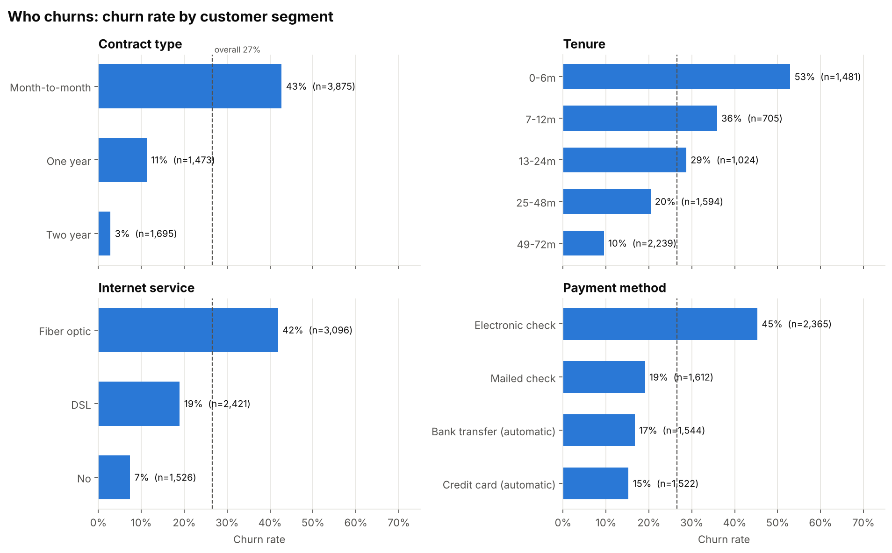
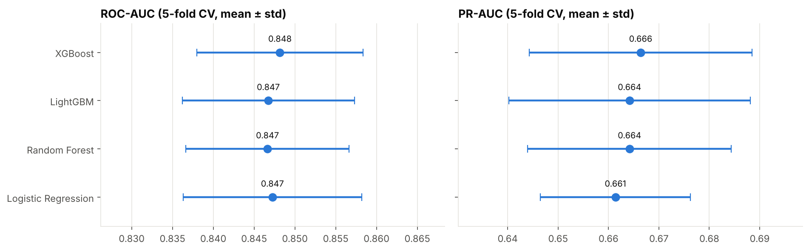
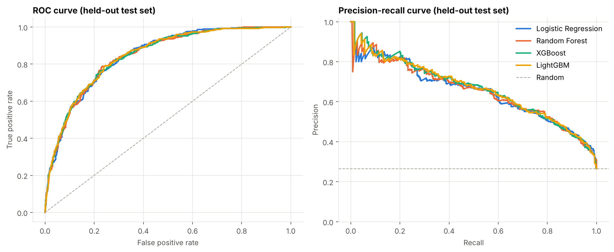
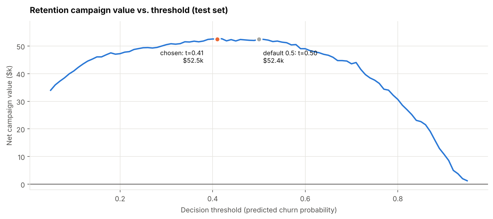
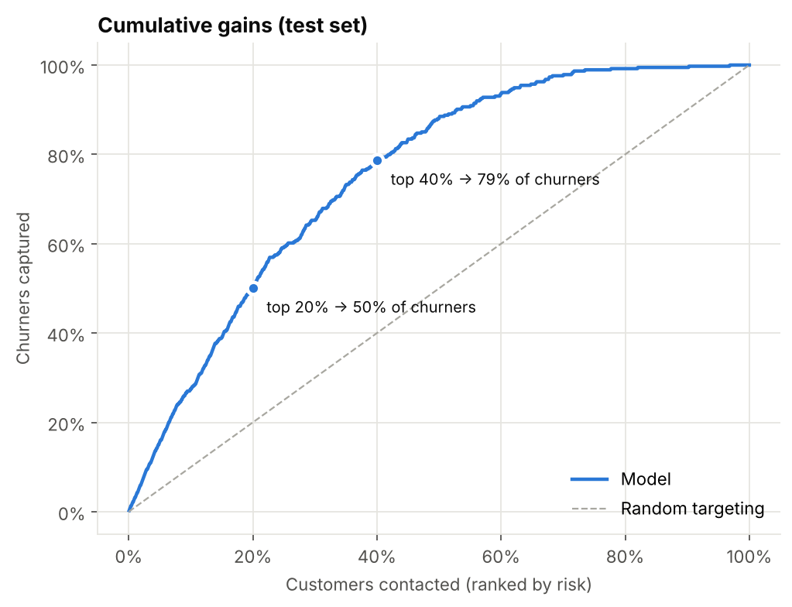
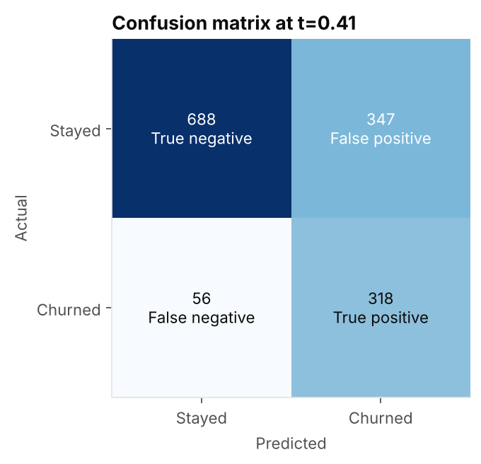
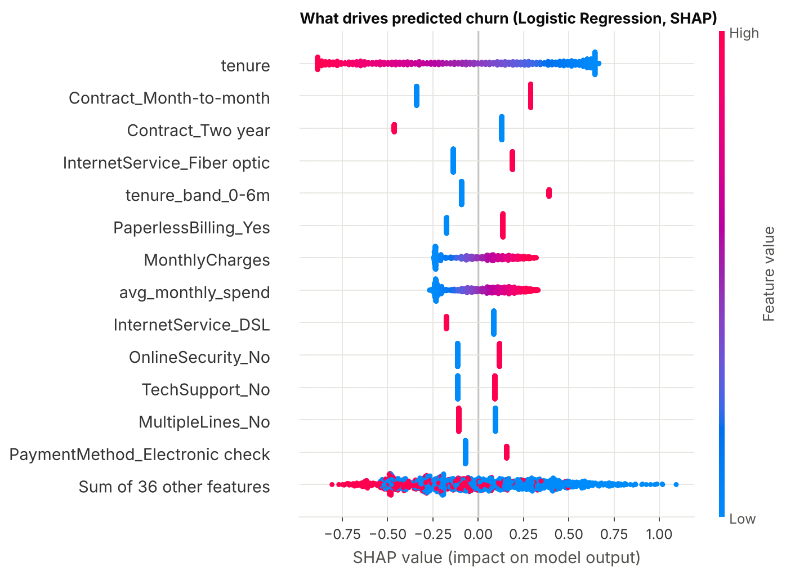

# Telco Customer Churn: Predicting and Targeting At-Risk Customers

A churn model for a subscription telecom business, built to answer a practical
question: **which customers should the retention team contact, and is it worth
the cost?** The pipeline cleans the data, compares five models under 5-fold
cross-validation, picks a decision threshold by expected campaign value, and
explains its predictions with SHAP.

Data: IBM's Telco Customer Churn sample, 7,043 customers and 20 attributes
(demographics, services, contract, billing). 26.5% of customers churned.

## Results

| | |
|---|---|
| Selected model | **Logistic Regression** (L2, C = 0.029, class-weighted) |
| ROC-AUC, held-out test set | **0.845** |
| PR-AUC, held-out test set | **0.652** (random guessing: 0.265) |
| Recall at chosen threshold (0.41) | **85%** of churners flagged |
| Precision at chosen threshold | **48%** of flagged customers actually churn |
| Top 20% riskiest customers | contain **50%** of all churners |
| Campaign value vs. offering everyone | **$52.5k vs. $27.5k** on 1,409 test customers, with half the contacts |

The main modeling finding: **a tuned logistic regression matches XGBoost,
LightGBM and Random Forest.** All four score 0.847 to 0.848 ROC-AUC in
cross-validation, and the gaps are far smaller than the fold-to-fold spread.
Under the one-standard-error rule the simplest model wins, so the shipped model
is the one a retention team can read coefficient by coefficient.

## Who churns



- **Contract is the strongest signal.** Month-to-month customers churn at 43%,
  against 11% on one-year and 3% on two-year contracts.
- **Risk is front-loaded.** Over half (53%) of customers in their first six months
  leave; past four years it drops to 10%.
- **Fiber optic customers churn at 42%,** more than double DSL (19%), despite
  being the premium product. That points to a price or service-quality problem
  worth investigating, not just a customer-mix effect.
- **Electronic check payers churn at 45%,** roughly three times the rate of
  customers on automatic payments (15 to 17%).

## Model comparison



| Model | CV ROC-AUC | CV PR-AUC | Test ROC-AUC | Test PR-AUC |
|---|---|---|---|---|
| Baseline (majority class) | 0.500 | 0.265 | 0.500 | 0.265 |
| **Logistic Regression** | 0.847 ± 0.011 | 0.661 ± 0.015 | 0.845 | 0.652 |
| Random Forest | 0.847 ± 0.010 | 0.664 ± 0.020 | 0.844 | 0.653 |
| XGBoost | 0.848 ± 0.010 | 0.666 ± 0.022 | 0.846 | 0.664 |
| LightGBM | 0.847 ± 0.011 | 0.664 ± 0.024 | 0.847 | 0.663 |

Each model was tuned with a 25-iteration randomized search over 5 stratified
folds, optimizing PR-AUC (average precision), which suits a 26% positive class
better than accuracy or recall alone. The held-out curves confirm the tie:



## From scores to decisions

A probability is only useful once it becomes a decision. The pipeline values a
retention campaign under explicit, editable assumptions in
[`src/config.py`](src/config.py):

- each retention offer costs **$50**
- the offer keeps **30%** of the churners who receive it
- a saved customer is worth **12 months** of their own monthly bill

The threshold is chosen on **out-of-fold training predictions** and only then
applied to the test set, so the test numbers below are not tuned on themselves.

| Strategy (1,409 test customers) | Customers contacted | Net value |
|---|---|---|
| No campaign | 0 | $0 |
| Offer everyone | 1,409 | $27,524 |
| Model, default threshold 0.50 | 577 | $52,446 |
| **Model, value-optimized threshold 0.41** | **665** | **$52,491** |



Two takeaways. Targeting with the model nearly **doubles campaign value while
contacting about half as many customers** as a blanket offer. And the value curve
is flat between roughly 0.35 and 0.55, so the exact threshold barely matters:
class weighting already put the default near the optimum. That flatness is
useful to know, because it means the recommendation is robust to small errors
in the cost assumptions.

<p float="left">
  
  
</p>

If the team can only make a limited number of calls, the gains curve answers
that directly: the riskiest 20% of customers hold half of all churners, and the
riskiest 40% hold 79%.

## What drives the predictions



SHAP values agree with the segment analysis. Short tenure, month-to-month
contracts, fiber optic service, higher monthly charges, paperless billing,
electronic check payment, and the absence of online security or tech support all
push predicted risk up. Two-year contracts and long tenure pull it down hardest.

## Recommendations

1. **Onboarding program for the first six months**, where churn is above 50%.
2. **Contract migration offers** for month-to-month customers, the single
   largest risk factor and the largest group (55% of the base).
3. **Bundle online security and tech support** into fiber plans. Their absence is
   a consistent risk signal, and it is cheaper than a price cut.
4. **Move electronic check payers to autopay**, for example with a small
   one-time bill credit.
5. **Measure the real save rate with a holdout group.** The 30% assumption drives
   the dollar figures above; a controlled test would replace it with a measured
   number and open the door to uplift modeling.

## Method

1. **Cleaning.** `TotalCharges` is stored as text with 11 blanks. All 11 belong
   to customers with tenure 0 who had not been billed yet, so they are set to 0
   (verified with an assertion) rather than imputed.
2. **Feature engineering.** Number of add-on services, average historical monthly
   spend, current bill minus historical average (a price-change signal), tenure
   bands, and an autopay flag.
3. **Leak-free preprocessing.** Scaling and one-hot encoding live inside a
   scikit-learn `Pipeline`, so they are fit on training folds only.
4. **80/20 stratified split** (5,634 train, 1,409 test). The test set is used once,
   at the end.
5. **Imbalance handling** with class weights (`scale_pos_weight` for XGBoost),
   not resampling, so predicted probabilities stay meaningful.
6. **Model selection** by 5-fold CV PR-AUC with the one-standard-error rule.
7. **Threshold selection** by expected campaign value on out-of-fold predictions.
8. **Explanation** with SHAP on the selected model.

## Limitations

- The campaign economics are illustrative, so the dollar amounts should not be
  quoted as a forecast. The ranking is robust, though: across 60 combinations
  (offer cost $25 to $100, save rate 10% to 50%, 6 to 24 months retained),
  model targeting beat a blanket offer every time. In the two harshest cases
  ($75+ offers that save only 10% of churners for 6 months) no campaign was the
  best option, which the value curve also reports correctly.
- The dataset is a single static snapshot with no timestamps, so there is no
  out-of-time validation. A production model would be validated on a later period.
- Tenure, `TotalCharges` and the tenure bands are correlated, so SHAP splits
  credit between them. Read them as one "customer age" signal.

## Run it

```bash
git clone https://github.com/kkriday/Telco-Churn-Prediction.git
cd Telco-Churn-Prediction
pip install -r requirements.txt
python run_pipeline.py
```

The full run takes about 8 minutes on a laptop and regenerates everything in
`reports/`. Results are reproducible with the fixed seed in `src/config.py`.

## Project structure

```
├── data/
│   └── WA_Fn-UseC_-Telco-Customer-Churn.csv
├── src/
│   ├── config.py          # paths, seed, campaign assumptions
│   ├── data.py            # loading and cleaning
│   ├── features.py        # feature engineering, preprocessing
│   ├── models.py          # candidate models and search spaces
│   ├── evaluate.py        # metrics, campaign value, threshold search
│   └── plots.py           # report figures
├── reports/
│   ├── metrics.json       # every number quoted in this README
│   ├── model_comparison.csv
│   └── figures/
├── course_submission/     # original team script and presentation
├── run_pipeline.py        # end-to-end entry point
└── requirements.txt
```

## Tech stack

| Area | Tools |
|---|---|
| Language | Python 3.11 |
| Data | pandas, NumPy |
| Modeling | scikit-learn, XGBoost, LightGBM |
| Explainability | SHAP |
| Visualization | Matplotlib |

## Project history and credits

This started as a team project for **Data Programming (Fall 2025)** by Tejas
Sanjeev Vaidya (team manager), Anusha Bellavara Mallikarjuna, Gouri Sharma,
Kriday Kallalathil and Tejaswini Waghmare. The original script and slides are
kept in [`course_submission/`](course_submission/).

This version rebuilds that analysis and implements the items the team listed as
future work: k-fold cross-validation, XGBoost and LightGBM, engineered features,
threshold optimization and cost-sensitive evaluation. It also fixes two issues
in the original: the scaler was fit before the train/test split (data leakage),
and tuning optimized recall alone, which rewards flagging nearly everyone.

Dataset: IBM Telco Customer Churn sample data, also distributed on Kaggle.
